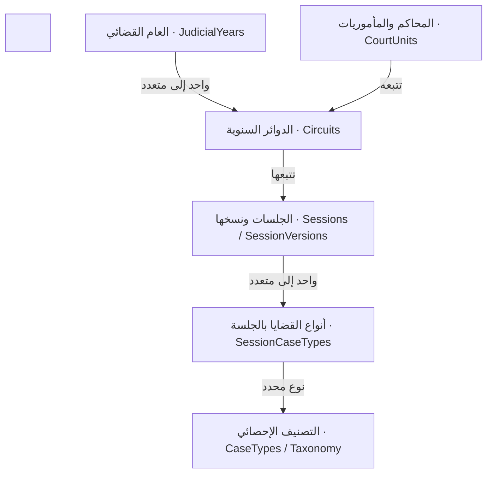
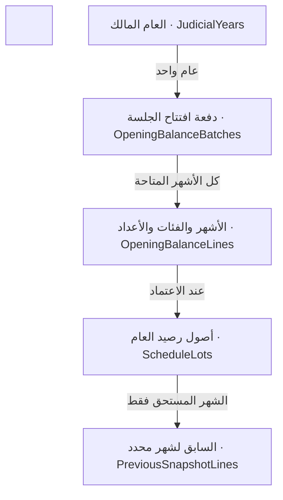
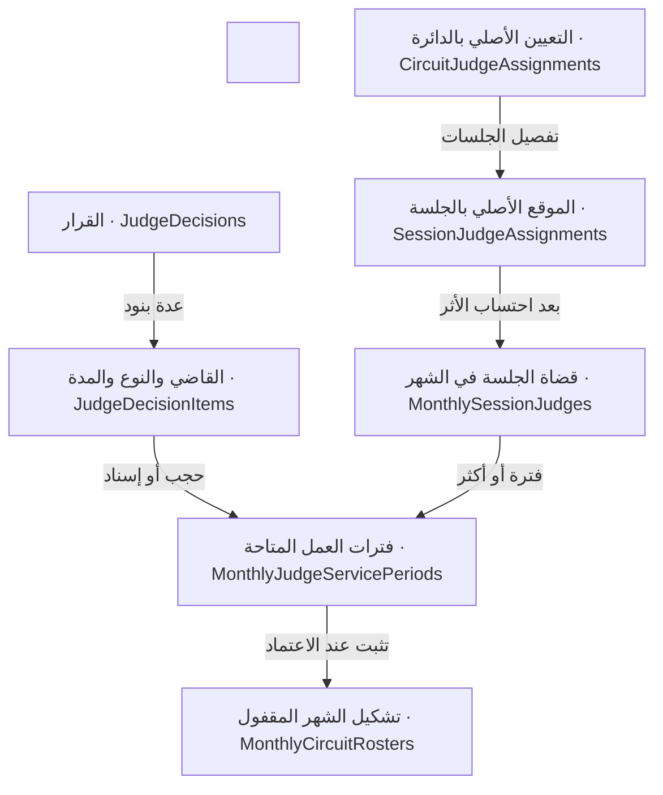

## تصميم منقّح يبدأ من قواعد العمل

مراجعة الإكسل وتحديث العلاقات والأرصدة والقضاة والطباعة | الإصدار 3

**القرار الأساسي** العام القضائي هو مالك التشكيل والجلسات والأرصدة. يبدأ كل عام بدفتر أرصدة يدوي مستقل، وتبقى السنوات القديمة محفوظة للعرض والتقارير دون أن تدخل في حساب السابق للعام الجديد.

هذا الملحق يستبدل أجزاء الإصدار 2 المتعلقة بترحيل العام، وسنة القيد في الجنح، وتكليفات القضاة، وتصحيح الإحصائية بعد الاعتماد. بقية القواميس والعلاقات تبقى مرجعًا، مع التعديلات المحددة هنا. لا يُقرأ الإصداران كبديلين متساويين عند التعارض.

| المحتويات | ما تتناوله |
| :---- | :---- |
| تحليل 29 شيتًا | قراءة بنية الملف وصيغ الربط وكود نقل البيانات إلى نماذج الطباعة. |
| قواعد التشغيل | أرصدة مستقلة، قرارات مؤرخة، تشكيل شهري ثابت، وحكم مرتبط بالقاضي والنوع. |
| 18 تعريف جدول و130 حقلًا | ترجمة الأسماء، وظيفة كل حقل، والقيود اللازمة؛ ثم قائمة تعديل بقية الجداول. |
| 6 خرائط تصدير | مدني كلي، أسرة، جنح جزئي، مستأنف، أحداث، ومدني جزئي. |

الحالة: تصور تفصيلي وخريطة مصدر للمبرمج؛ لم تُنشأ قاعدة بيانات تشغيلية أو خدمة تصدير XLSX في هذه الجولة.

## ما ثبت من ملف الإكسل

المصدر: نسخة اكتوبر من احصاء 2025 \- 2026.xlsm؛ فُحصت مكونات الملف وكود VBA دون تشغيله.

| المحور | الدليل داخل الملف | النتيجة ودلالتها |
| :---- | :---- | :---- |
| الفترة | الاعدادات\!B2:B3 | القيمة الحالية يوليو 2026 رغم تسمية الملف أكتوبر؛ يعتمد التطبيق شهر الاختيار الخارجي. |
| التنظيم | التشكيل\!A4:T47 وA57:T99 وA114:T165 وA218:T299 | الدوائر والجلسات وأنواعها وأيامها منفصلة عن جدول أسماء القضاة وأدوارهم وحالتهم. |
| مدني كلي | print\_Madany\_Circle / A2:BL37 | طباعة جلسة مدني تنقل الإنتاج وخانات أحكام أربعة قضاة من شيت الإدخال. |
| الأسرة | print\_Family\_Circle / A290:BS405 | أربع صفحات جلسات مسبقة، كل صفحة 29 صفًا، ونقل أربعة قضاة لكل صفحة. |
| سعة القضاة | مدني كلي\!BD:EI ؛ اسرة\!BE:FE | توزيع الإدخال يشمل ستة قضاة في مجموعات ثلاثة أعمدة كبرى × مجموعتين من الصفوف. |
| المؤجلات | مدني كلي\!EO7 \= AT7-EQ7-EP7 | مثال ملء تلقائي لباقي المحجوز في أول شهر؛ يخالف اشتراط إدخال توزيع الشهور يدويًا. |
| المعادلة | مدني كلي\!Z7 | المقدم يضم التقصير ويطرح الإحالة من الدائرة ويضيف الإحالة إليها. |
| منع الازدواج | الاحداث\!F14 وF20 | الأحداث تستدعي أعدادًا من الجنح المستأنف؛ لا تجمع الشيتين كحركتين مستقلتين. |

## الاختيار والتنظيم والاختصاص

القسم الرئيسي طريقة للوصول إلى الجلسات؛ لا يجعل كل جلسات الدائرة من النوع نفسه.

الاختصاص المكاني يرتبط بنسخة الجلسة من خلال SessionJurisdictions؛ لا ننقله إلى الدائرة. تبقى المحكمة العمالية المستقلة مستقلة في الهيكل، ويضمها نطاق التقارير والصلاحيات إذا كانت مشمولة بالنظام.

تسلسل الشاشة: شهر وسنة الإحصاء خارج الإدخال ثم مدني/جنح/أسرة/عمالية ثم المحكمة أو المأمورية ثم الدائرة ثم الجلسات المطابقة للاختيار فقط. في المدني تتيح الأنواع الجزئي والكلي والمستعجل بحسب الجلسات الفعلية؛ دائرة مختلطة لا تعرض جلسات الجنح عند اختيار المدني.

## أرصدة افتتاحية مستقلة لكل عام

لا روابط حسابية من سبتمبر القديم إلى أكتوبر الجديد؛ فصل السنة لا يعني حذف تاريخها.

مثال: افتتاح أكتوبر 40 ونوفمبر 20 وديسمبر 10\. سابق أكتوبر \=40؛ سابق نوفمبر يبدأ من رصيده الافتتاحي 20 ويضاف إليه ما استحق لنوفمبر من مؤجلات أكتوبر، بعد خصم التقصير الصحيح. لا يُستخدم 70 كسابق أكتوبر.

كل أصل رصيد يحمل العام الذي يملكه، وتاريخ استحقاق كاملًا. مؤجل من سبتمبر إلى أكتوبر قد يظهر في جرد العام القديم، لكنه لا يغذي أكتوبر للعام الجديد. تُدخل قيمته ضمن الافتتاح الجديد يدويًا إذا كانت موجودة في الجرد المستلم.

## سنة القيد: تُطبق حيث يلزم فقط

التعديل يلغي الافتراض السابق بأن الجنح تعمل على سنة قيد واحدة.

| الفئة | النمط | التخزين والسلوك |
| :---- | :---- | :---- |
| مدني جزئي وكلي ومستعجل | Bands | صف لكل شريحة، ومنها أقدم سنة وما قبلها، وفق سياسة العام القضائي. |
| الأسرة والعمال المدني | Bands | صفوف السنوات المقررة لهذه الأنواع؛ لا نفرض عليها مدى سنوات المدني. |
| جنح جزئي ومستأنف وأحداث | None | صف واحد لكل نوع إحصائي في الجلسة، بلا سنة قيد ظاهرة أو مخفية. |
| جنح عمالية | None | يتبع طريقة الجنح حتى لو كان تصنيفه الرئيسي عمالية. |

**القيمة المخزنة للجنح** CaseYearBandId \= NULL. لا نستخدم 0 أو سنة الإحصائية أو سنة افتراضية. ويمنع قيد التفرد تكرار الصف الواحد للقسم الإحصائي.

إذا جمعت جلسة أحداث واحدة جنحًا وجنايات، يحفظ لكل نوع تفصيل مستقل بلا سنوات، ويمكن عرضهما في شاشة واحدة. يمكن جمعهما في إجمالي العرض، لكن لا يجوز طمس الفصل المطلوب في تقارير الجنح والجنايات. كذلك تبقى أحداث الدرجة الجزئية منفصلة عن المستأنفة.

## القضاة: أصل سنوي وقرارات مؤرخة

ستة مواقع معرّفة بالقاموس، وليست ستة أعمدة ثابتة داخل جدول الدائرة.

الرئيس، عضو يمين، عضو يسار، عضو يسار اليسار، عضو خامس، عضو سادس. يعرض الاسم والموقع وفترة التوفر، مع الأقدمية والدرجة عندما يطلبهما نموذج الطباعة.

## كيف يظهر القاضي في إحصائية الشهر؟

المثال التالي لإحصائية يوليو؛ بداية ونهاية القرار يومان مشمولان بالمدة.

| الفترة أو الحالة | النتيجة في الشهر |
| :---- | :---- |
| ندب داخلي 10-20 يوليو | يظهر في الدائرة الأصلية من 1 إلى9 ومن21 إلى31، ويظهر في الجهة المنتدب إليها من10 إلى20. |
| إجازة طوال 1-31 يوليو | لا يظهر ضمن المتاحين في أي جلسة يشملها قرار الإجازة. |
| إجازة 1-15 يوليو | يظهر بفترة16-31؛ لا يُستبعد الشهر كله بسبب غياب جزئي. |
| نقل من15 يوليو لنهاية العام | يظهر في الأصل1-14، ثم لا يظهر به في الأشهر التالية؛ يظهر بالمستقبل من15 يوليو إذا داخل النطاق. |
| تعيين جديد من20 يوليو | يظهر في الجلسات التي عُين بها من20 إلى31 فقط. |
| تغيير رئيس الدائرة منتصف الشهر | قد يظهر القديم والجديد للموقع نفسه مع فترة كل منهما؛ لا يدمجان تحت اسم واحد. |

خوارزمية التوفر: نبدأ بالتعيين السنوي، نطرح اتحاد فترات الإجازة والنقل والندب عن المصدر، ثم نضيف إسنادات الوجهة. يظهر القاضي إذا بقيت له فترة واحدة على الأقل داخل الشهر. القرار المؤقت يعيد الأصل تلقائيًا بعد انتهائه، ما لم يوجد قرار آخر سارٍ.

التقارير هنا شهرية العدد؛ لا يحول النظام العدد إلى أحكام مؤرخة يوميًا من دون إدخال تاريخ لكل حكم. نتحقق من أهلية القاضي في جزء من الشهر، ونعرض مدة عمله بوضوح.

## ما الذي يلزم في كل قرار؟

تاريخ البداية والنهاية والقاضي والقرار إلزامية في جميع الحالات، داخل العام القضائي الجاري.

| نوع القرار | البيانات الإلزامية والأثر | ما بعد انتهاء المدة |
| :---- | :---- | :---- |
| ندب مؤقت داخلي | المصدر والوجهة والموقع في الوجهة؛ يحجب الأصل طوال المدة ويضيف العمل بالوجهة. | يعود للأصل إذا ظل تعيينه قائمًا ولم يمنعه قرار آخر. |
| نقل داخلي | المصدر والوجهة والموقع؛ تسري المدة كما في القرار. | إذا كان لنهاية العام تنتهي الفترة بنهاية سبتمبر دون إسناد تلقائي للسنة التالية. |
| نقل خارج النطاق | نطاق المحكمة واسم الجهة الخارجية؛ يحجب كل جلسات القاضي التي يشملها القرار. | لا عمل داخل النطاق خلال الأثر؛ لا يُنشأ تعيين داخلي بالجهة الخارجية. |
| إجازة | نطاق المحكمة أو الدائرة أو الجلسة وفق القرار؛ بلا جهة استقبال. | يستأنف التعيين السابق المتبقي بعد نهاية الإجازة. |
| تعيين قاضٍ جديد | الدائرة المستقبلة والجلسة أو الجلسات والموقع؛ لا يلزم مصدر سابق. | تنتهي الفترة المؤقتة؛ لا نخترع مكانًا أصليًا يعود إليه إذا لم يكن له أصل. |

قرار يشمل عدة جلسات يفصل إلى بنود واضحة لكل جلسة أو يوسع إلى جلسات الدائرة عند التسجيل. يمنع تعارض المقعد في المدة نفسها، وتراجع جميع الدوائر المتأثرة عند فحص الأشهر المقفولة. نطاق Court يحدد بالمحكمة صاحبة القرار والجهات الداخلة في سلطتها المسجلة.

**لا علاقة بين ترتيب تسجيل القرار وأولويته القانونية** عند تعارض قرارين في القاضي والجلسة والمدة يعرض النظام التعارض ويمنع التطبيق الآلي. لا يستخدم آخر سجل لتغيير شهر معتمد، ولا يسقط إجازة بسبب قرار ندب أقدم.

## الاعتماد يقفل البيانات والتشكيل

تثبيت التاريخ جزء من الحساب الصحيح، وليس مجرد تعطيل زر التعديل.

| النطاق | القاعدة |
| :---- | :---- |
| الإحصائية المعتمدة | يحظر تحديث أو حذف أي مقدم أو حكم أو بيان مستقل أو توزيع أو تقصير تابع لها، ويحظر إنشاء نسخة بديلة تتجاوز هذا القفل. |
| تشكيل الدائرة للشهر | أول اعتماد لإحصائية داخل الدائرة يقفل تشكيل الدائرة وكل جلساتها في ذلك الشهر؛ تستمر بقية الجلسات في تسجيل أعدادها على التشكيل المثبت. |
| المعلومات التاريخية | لا تؤثر تعديلات أسماء القضاة أو الجلسات والتصنيفات مستقبلًا في نسخة الشهر أو ملفات التصدير المحفوظة. |
| قرار بأثر سابق | يسمح بالقرار لفترات مفتوحة فقط. إذا مس قرار مصدرًا أو وجهة مقفولة، يمنع تطبيقه على هذه الفترة ويبين سبب المنع. |
| عملية الاعتماد | فحص الصلاحية والقفل والإصدار، تثبيت السابق والتشكيل، ترحيل المؤجلات والتقصير، ثم الاعتماد في معاملة واحدة. |
| مستخدمون متزامنون | يتغير رمز الإحصائية عند كل تغيير بتفاصيلها؛ لا يكفي RowVersion على الرأس إذا لم يحدث عند تعديل الأبناء. |

لا يعاد فتح المعتمد ضمن هذه النسخة. إذا احتاج العمل مستقبلًا إلى نظام تصحيح رسمي، يُصمم كإجراء مستقل بطلب واضح؛ لا يُفترض وجود استثناء إداري يسمح بالتعديل الآن.

## تسجيل الحكم والتقرير الذي طلبته

هوية القاضي محفوظة، وموقعه وتشكيل الشهر محفوظان معها.

| العمود المطلوب في تقرير الأحكام | المصدر في النموذج |
| :---- | :---- |
| رقم معرف السجل | JudgeJudgmentCounts.Id |
| رقم الإحصائية | StatisticRows / StatisticSections / StatisticRevisions / MonthlyStatistics |
| رقم شريحة سنة القيد | StatisticRows.CaseYearBandId؛ فارغ للجنح |
| رقم القاضي | MonthlySessionJudges.JudgeId |
| رقم نوع الحكم | CaseTypeJudgmentRules / JudgmentTypes |
| عدد الأحكام | JudgeJudgmentCounts.Count |

ننشر View باسم vw\_JudgeJudgments يعرض هذه الأعمدة مباشرة، ومعها العام القضائي والمحكمة والدائرة والجلسة ونوع القضية واسم القاضي وموقعه وشجرة الحكم. هكذا تحصل على التقرير بالشكل البسيط الذي طلبته دون تكرار مفاتيح يمكن أن تتعارض.

**رقم الجلسة وحده غير كافٍ في الجلسة المشتركة** لابد من StatisticSectionId أو مسار StatisticRowId إلى القسم الذي يثبت CaseTypeId. الجلسة قد تضم أكثر من نوع؛ تحديد الحكم بالجلسة فقط سيخلط جنح الأحداث بجناياتها.

مد الأجل والإعادة للمرافعة يسجلان في JudgeActionCounts ويرتبطان بقاضي الشهر نفسه؛ يظهران بجوار المؤجلات ويُوزعان، ولا يضافان لمجموع الأحكام. أحكام الإثبات والفرعي تُحسب أحكامًا مع وجوب توزيعها بوصفها دعاوى باقية، دون عدّها مرتين في معادلة ضبط الإنتاج.

## التقصير والسابق: حركة يمكن تتبعها

الشهر المقصر منه يخزن بتاريخ كامل؛ أغسطس 2026 ليس أغسطس 2027\.

| الخطوة | ما يسجله النظام |
| :---- | :---- |
| 1\. أصل الرصيد | رصيد جلسة معينة لشهر سبتمبر2026، نوع مدني كلي، شريحة2023، فئة مؤجل محددة، العدد10، والعام المالك2025/2026. |
| 2\. إدخال التقصير | اختيار سبتمبر2026 من الأرصدة المتاحة، تحديد الفئة، وإدخال عدد3 داخل إحصائية يوليو لنفس الجلسة والنوع والشريحة. |
| 3\. الاعتماد | تزيد مقدمات يوليو3 ويقل المتاح من أصل سبتمبر3 في معاملة واحدة. الطلب المكرر لا ينتج حركة ثانية. |
| 4\. فتح سبتمبر | يحمل السابق7 من هذا الأصل، مع بيان: أصل10؛ قُصّر3 إلى يوليو؛ صافي7. يضاف أي أصل آخر مستحق للشهر مرة واحدة. |
| 5\. منع التعارض | لا يمكن اعتماد عملية رجعية تغير السابق أو توزيعًا معتمدًا بالفعل. يرفض تجاوز المتاح ولو حاول مستخدمان في وقت واحد. |

التفاصيل تحفظ عدد التقصير ورصيد المصدر الذي يحمل رقم الجلسة ونوع القضية وفئة التأجيل وشهر المصدر. لا يُختزل النوع في كلمة واحدة مبهمة: نوع القضية شيء، وسبب التأجيل الذي سُحب منه العدد شيء آخر.

السابق يُحسب عند بدء المسودة من المصادر المعتمدة للعام نفسه ولا يحرر يدويًا. عند الاعتماد يفحص النظام أن مصادره لم تتغير؛ إن تغيرت يُحدّث السابق مع تنبيه للمراجعة قبل الاعتماد. غياب افتتاح أو مصدر مطلوب لا يعرض كسابق صفري مكتمل.

**توزيع المؤجلات يدوي بالكامل** المؤجل للتقرير ولأسباب أخرى يُكتب في الإنتاج؛ العدد المطلوب توزيعه يأتي منه. كل شهر يكتب المستخدم حصته، حتى لو كان شهرًا واحدًا. مجموع التوزيع يجب أن يساوي الأصل لكل فئة ولكل صف؛ لا يملأ النظام الشهر الأول بالباقي تلقائيًا.

## خريطة نماذج التصدير في الملف

مساحات الطباعة التالية كما هي محفوظة أو مستخدمة بالكود، وليست تلقائيًا حدود كل البيانات المطلوبة.

| الشيت أو النموذج | المساحة الأصلية | سلوك التصدير المقترح |
| :---- | :---- | :---- |
| مدني كلي / نماذج الطباعة | A2:BL37 | صفحة لكل جلسة من نموذج الطباعة، مع متابعة للقضاة الزائدين؛ تجميع حسب المحكمة ثم الدائرة والجلسة. |
| اسرة / نماذج الطباعة | A290:BS318 | صفحة لكل جلسة، مع حقول الأسرة وندب حكمين؛ تجميع كل الجلسات دون سقف ثابت. |
| جنح المحاكم الجزئية | A1:AT220 | نفس رؤوس وصفوف الإدخال والإجماليات؛ صف واحد لكل نوع جلسة بلا سنوات. |
| جنح مستأنف | A1:BS105 | نفس نموذج الإدخال؛ تتبع بيانات القضاة الموجودة خارج المساحة المحفوظة في ورقة متابعة عند طلب التفاصيل. |
| الاحداث | A1:BZ24 | نفس نموذج الأحداث، مع الفصل المخزن بين الجنح والجنايات والجزئي والمستأنف. |
| كشف انتاج مدني جزئي | A1:DM516 | الإنتاج والأحكام والمؤجلات على امتداد الورقة، مع تكرار الرؤوس وأعمدة تعريف الدائرة. |

المقاسات والدمج والألوان وحدود الخلايا والصفوف المخفية والفواصل والعناوين المتكررة تحفظ في نسخة قالب مستقلة. لا تُرسم الجداول من الصفر لكل تصدير، ولا تُستخدم لقطة شاشة من صفحة الإدخال في الويب كبديل لملف Excel.

## تفصيل ربط نموذج المدني الكلي

s \= بداية جلسة الإدخال في التشكيل\!J، وp \= أول صف في كتلة الطباعة؛ أول نموذج يبدأ بالصف2.

| المحتوى | نطاق المصدر في مدني كلي | نطاق الوجهة في نموذج الطباعة |
| :---- | :---- | :---- |
| إنتاج سنوات القيد الخمس | M(s+1):AZ(s+5) | M(p+7):AZ(p+11) |
| القاضي الأول | BD(s+1):CE(s+5) | B(p+21):AC(p+25) |
| القاضي الثاني | CF(s+1):DG(s+5) | AD(p+21):BE(p+25) |
| القاضي الثالث | BD(s+8):CE(s+12) | B(p+28):AC(p+32) |
| القاضي الرابع | CF(s+8):DG(s+12) | AD(p+28):BE(p+32) |
| ما لا ينقله الماكرو من القضاة | المجموعة DH:EI في مجموعتي الصفوف | صفحات متابعة بنفس عناوين الأحكام |

هذه هي خريطة نقل الماكرو الحالي؛ التنفيذ الجديد يربط رموز الحقول بهذه المواضع، ولا يعتمد رقم الصف المخزن في الملف كمعرّف للجلسة في قاعدة البيانات. تتكرر الكتلة 36 صفًا، ويُحفظ ترتيب المحاكم والدوائر والجلسات.

**توزيع المؤجل في المصدر الحالي** فرعي وإثبات EK:EM؛ محجوز EO:EQ؛ مد الأجل ES:EU؛ الإعادة EW:EX؛ أسباب أخرى FK:FM؛ تقرير FO:FQ. هذه المواضع من الملف المقروء نفسه؛ رؤوس الشهور متغيرة وتخزن بتاريخها الكامل في قاعدة البيانات.

## تفصيل ربط نموذج الأسرة

أول نموذج يبدأ بالصف290، وتتكرر الكتلة29 صفًا. المصدر يعرض أربع شرائح سنوات في هذا الإصدار من الملف.

| المحتوى | نطاق المصدر في اسرة | نطاق الوجهة في نموذج الطباعة |
| :---- | :---- | :---- |
| الإنتاج | M(s+2):BA(s+5) | U(p+6):BI(p+9) |
| القاضي الأول | BE(s+2):CM(s+5) | B(p+17):AJ(p+20) |
| القاضي الثاني | CN(s+2):DV(s+5) | AK(p+17):BS(p+20) |
| القاضي الثالث | BE(s+9):CM(s+12) | B(p+23):AJ(p+26) |
| القاضي الرابع | CN(s+9):DV(s+12) | AK(p+23):BS(p+26) |
| القاضيان الخامس والسادس | المجموعة DW:FE في مجموعتي الصفوف | متابعة، عند وجود بيانات للعضوين |

أحكام الأسرة تتضمن ندب حكمين. عدد شرائح القيد لا يثبت في الكود إلى الأبد؛ إذا تغير قرار سنوات العمل يعاد تكرار الصفوف أو تنشأ صفحة متابعة مقروءة، مع حفظ نسخة القالب التي استخدمت.

**فصل مصدر البيانات عن شكل الورق** توزيع الأسرة الحالي يجمع التقرير والأسباب الأخرى في FV:FX. قاعدة البيانات تحتفظ بالفئتين منفصلتين لضبط الإدخال، ويجوز للنموذج الأصلي عرض مجموعهما في هذا الموضع. يجمع التقرير حسب القالب دون فقد تفصيل الأصل.

## الجنح والأحداث والمدني الجزئي

أهم نطاقات الربط؛ بقية المقاسات والرؤوس والدمج محفوظة في ملف خريطة التصدير المرفق.

| نوع النموذج | تفاصيل الربط |
| :---- | :---- |
| جنح جزئي | السابقH؛ باقي المقدمI:M؛ جملتهN؛ المؤجلاتP:V وجملتهاO؛ الأحكامY:AS و«أخرى»AT، وجملة الأحكامW؛ توزيع القاضيAU:BA. الرؤوس5:11. |
| جنح مستأنف | المقدمF:K وجملتهL؛ المؤجلاتO:U وجملتهاN؛ الأحكامX:AW مع الإجماليات الوسيطة؛ الإجماليV؛ توزيع القضاةAX:CG وإجمالياتهمCH:CO. الرؤوس2:11. |
| أحداث | نفس مجموعات أعمدة المستأنف تقريبًا؛ الرؤوس التفصيلية حتى12 والبيانات من13. بعض الأعداد روابط من شيت المستأنف، فلا تستورد أو تجمع كإحصائية ثانية. |
| مدني جزئي | سنة القيدG؛ المقدمH:T وجملتهU؛ الأحكامX:AM وإجماليهاAN؛ المؤجلاتAO:AS وإجماليهاAT؛ أحكام القاضيAX:CA؛ التوزيعCD:DM. |
| استكمال المدني الجزئي | الرؤوس2:8 وتعريف الدائرةB:F يتكرران. السنوات المعادة فيAW وCC للعرض فقط، وليست صفوف بيانات إضافية. |

تُربط أنواع الأحكام الدقيقة من القاموس بالأعمدة التفصيلية؛ توزيع القضاة في بعض شيتات الجنح يعرض فئات مجمعة فقط، لكن التخزين الجديد يحتفظ بنوع الحكم التفصيلي ويجمعه لهذه الأعمدة عند التصدير.

## حدود النموذج الحالي التي يجب معالجتها

الحفاظ على الشكل لا يستلزم إعادة نسخ القيود التي تُسقط بيانات.

| الملاحظة المثبتة | المعالجة في النظام المقترح |
| :---- | :---- |
| الماكرو: أربعة قضاة؛ ثماني جلسات مدني وأربع جلسات أسرة كحدود مصفوفات جاهزة. | تكرار صفحات حسب عدد الجلسات الفعلي، وصفحات متابعة القضاة والأدوار المتعاقبة. |
| مساحة المستأنف تنتهيBS والأحداثBZ مع استمرار أعمدة القضاة حتىCO. | اعتماد ملف قالب مستقل لكل نموذج، واختيار ما يطبع في الصفحة الأصلية وما يتبعها من تفاصيل. |
| أمر طباعة جلسة مدني يضبط ws.PageSetup رغم أن printRange يتبع printSheet. | إعداد الصفحة يجب أن يطبق على ورقة النموذج التي سيصدرها النظام. |
| بعض رؤوس نماذج الطباعة تحتوي نص مدني كلي وقيمًا من آخر استخدام. | يفصل مصدر الأسرة ويصحح عنوان القالب في نسخته الجديدة؛ لا يترك عنوان مدني على نموذج أسرة. |
| شيت الأحداث يعتمد على مراجع من شيت المستأنف. | القسم الإحصائي يملك الأرقام مرة واحدة؛ نموذج الأحداث والمستأنف قراءتان لنفس المصدر عند اشتراك الجلسة. |
| معاينة خارج Excel لا تثبت تطابق المقاسات أو نتائج كل الصيغ. | تحديد مرجعية محرك Excel والطابعة والخطوط عند اختبار التطابق، مع مقارنة صفحة فعلية لا مظهر المتصفح وحده. |

قرئت الصيغ المخزنة وقيمها المرجعية مباشرة. المعاينات المساعدة أظهرت قيودًا في فهم بعض صيغ Excel والعربية؛ لذلك لم تُستخدم أخطاء المعاينة كدليل على أخطاء جديدة في ملفك، ولم أدّع اختبار الطباعة النهائية في Microsoft Excel.

## الجداول المعدلة والجديدة

القاموس التالي يشرح ما تغير؛ لا يعيد نسخ جداول الصلاحيات والتصنيف التي لم تتغير.

| اسم الجدول | الهدف | الوضع |
| :---- | :---- | :---- |
| CaseTypes | أنواع القضايا | تعديل جزئي |
| OpeningBalanceBatches | دفعات الأرصدة الافتتاحية | بديل تعريف |
| OpeningBalanceLines | تفاصيل الأرصدة الافتتاحية | بديل تعريف |
| CircuitJudgeAssignments | تعيينات القضاة الأصلية بالدوائر | بديل تعريف |
| SessionJudgeAssignments | مواقع القضاة الأصلية بالجلسات | جديد |
| JudgeDecisions | قرارات شؤون القضاة | جديد |
| JudgeDecisionItems | بنود قرارات القضاة | جديد |
| MonthlyCircuitRosters | تشكيل الدائرة المثبت للشهر | جديد |
| MonthlySessionSnapshots | الجلسات المثبتة للشهر | جديد |
| MonthlySessionJudges | قضاة الجلسة المتاحون للشهر | جديد |
| MonthlyJudgeServicePeriods | فترات عمل القاضي داخل الشهر | جديد |
| StatisticRows | صفوف الإحصائية | بديل تعريف |
| JudgeJudgmentCounts | أحكام القضاة | بديل تعريف |
| ShorteningEntries | تفاصيل التقصير | جديد |
| ReportTemplates | تعريف نماذج التصدير | جديد |
| ReportTemplateVersions | إصدارات قوالب الطباعة | جديد |
| ReportExports | سجل ملفات التصدير | جديد |
| ReportExportItems | الإحصائيات الداخلة في التصدير | جديد |

## أنواع القضايا

CaseTypes | تعديل جزئي

توسعة التعريف الحالي لفصل العائلة الرئيسية عن طريقة إحصاء النوع.

| اسم العمود | الاسم بالعربية | نوع البيانات | الهدف والارتباط |
| :---- | :---- | :---- | :---- |
| Id | المعرّف | bigint / PK | رقم فريد يولده النظام. |
| Code | الكود | varchar(50) | كود ثابت وفريد. |
| NameAr | الاسم | nvarchar(200) | اسم النوع التفصيلي. |
| TaxonomyNodeId | فرع التصنيف | bigint / FK | ينتمي إلى المدني أو الجنح أو الأسرة أو العمالية. المرجع: CaseTaxonomyNodes. |
| CaseYearMode | سياسة سنة القيد | varchar(16) | Bands لصفوف السنوات؛ None للجنح بما فيها الجنح العمالية والأحداث. |
| StatisticsNature | طبيعة الإحصاء | varchar(16) | Civil أو Criminal أو Family؛ مستقل عن الجهة والعائلة الرئيسية. |

• هذه حقول الإضافة والربط المؤثرة؛ تبقى بقية حقول القاموس في الإصدار السابق.

• لا يكفي اختبار العائلة الرئيسية وحدها: جنح العمال قد تنتمي للعمالية وتعمل دون سنة قيد.

## دفعات الأرصدة الافتتاحية

OpeningBalanceBatches | بديل تعريف

رأس إدخال يدوي مستقل لكل جلسة سنوية؛ يجمع كل أشهر الأرصدة المتاحة.

| اسم العمود | الاسم بالعربية | نوع البيانات | الهدف والارتباط |
| :---- | :---- | :---- | :---- |
| Id | المعرّف | bigint / PK | رقم فريد يولده النظام. |
| JudicialYearId | العام القضائي | bigint / FK | مالك الأرصدة؛ يبدأ في أكتوبر وينتهي في سبتمبر. المرجع: JudicialYears. |
| SessionId | الجلسة السنوية | bigint / FK | الجلسة التي تُفتح لها الأرصدة؛ من العام نفسه. المرجع: Sessions. |
| Status | الحالة | varchar(16) | Draft ثم Approved؛ اعتماد واحد للدفعة. |
| SourceReference | مرجع الجرد | nvarchar(300) / NULL | وصف المستند الذي نُقلت منه الأرصدة يدويًا، دون ربط حسابي بالعام القديم. |
| CreatedByUserId | المُسجّل | bigint / FK | المستخدم الذي سجل العملية. المرجع: AppUsers. |
| CreatedAt | وقت التسجيل | datetime2 | وقت التسجيل الفعلي؛ يختلف عن تاريخ السريان. |
| ApprovedByUserId | المعتمِد | bigint / FK / NULL | صاحب اعتماد الأرصدة. المرجع: AppUsers. |
| ApprovedAt | وقت الاعتماد | datetime2 / NULL | يملأ مرة عند الاعتماد. |
| RowVersion | رمز التزامن | rowversion | لمنع الكتابة فوق إدخال مستخدم آخر. |

• تفرد العام \+ الجلسة. اعتماد الدفعة شرط لفتح الإحصائية المعتمدة؛ ويمكن اعتماد رصيد صفري صراحة.

• لا ترحيل آلي، ولا دفعة استكمال مرتبطة بسنوات قديمة بعد بدء العام. تحفظ الملفات القديمة للرجوع فقط.

## تفاصيل الأرصدة الافتتاحية

OpeningBalanceLines | بديل تعريف

رقم يدوي لكل شهر استحقاق ونوع قضية وفئة تأجيل وسنة قيد عند انطباقها.

| اسم العمود | الاسم بالعربية | نوع البيانات | الهدف والارتباط |
| :---- | :---- | :---- | :---- |
| Id | المعرّف | bigint / PK | رقم فريد يولده النظام. |
| BatchId | دفعة الافتتاح | bigint / FK | يُستدل منه على العام والجلسة. المرجع: OpeningBalanceBatches. |
| SessionCaseTypeId | نوع القضية بالجلسة | bigint / FK | يفصل أنواع الجلسة المشتركة. المرجع: SessionCaseTypes. |
| CaseYearBandId | شريحة سنة القيد | bigint / FK / NULL | مثل 2022 وما قبلها؛ فارغ للجنح. المرجع: CaseYearBands. |
| DueMonth | شهر وجود الرصيد | date | أول يوم من الشهر مع السنة؛ مثال أول نوفمبر 2026\. |
| DeferralReasonId | فئة المؤجل | bigint / FK | محجوز أو مد أجل أو إثبات أو تقرير أو غيرها. المرجع: DeferralReasons. |
| Count | العدد | int / NULL | عدد صحيح غير سالب. الفراغ مسموح في المسودة فقط. |

• تفرد الدفعة \+ نوع القضية \+ شريحة السنة بما فيها NULL \+ الشهر \+ الفئة.

• يدخل أكتوبر ونوفمبر وديسمبر كلٌ كسطر مستقل؛ لا يضاف إجمالي هذه الشهور إلى سابق أكتوبر.

• لا يُقبل شهر أقدم من بداية العام؛ أي استحقاق بعد نهايته يبقى في دفتر هذا العام ولا يغذي العام التالي.

## تعيينات القضاة الأصلية بالدوائر

CircuitJudgeAssignments | بديل تعريف

يحفظ عضوية القاضي الأصلية في دائرة سنوية وفق الجمعية أو قرار تعيين.

| اسم العمود | الاسم بالعربية | نوع البيانات | الهدف والارتباط |
| :---- | :---- | :---- | :---- |
| Id | المعرّف | bigint / PK | رقم فريد يولده النظام. |
| CircuitId | الدائرة السنوية | bigint / FK | العام يُستدل من الدائرة. المرجع: Circuits. |
| JudgeId | القاضي | bigint / FK | هوية مستقلة لا تتغير بالنقل. المرجع: Judges. |
| OrganizationVersionId | قرار التشكيل السنوي | bigint / FK / NULL | مرجع الجمعية عند التعيين السنوي. المرجع: OrganizationVersions. |
| DecisionItemId | بند قرار التعيين | bigint / FK / NULL | مرجع إنشاء عضوية جديدة أثناء العام. المرجع: JudgeDecisionItems. |
| EffectiveFrom | بداية السريان | date | أول يوم مشمول بالأثر. |
| EffectiveTo | نهاية السريان | date | آخر يوم مشمول بالأثر؛ نهاية العام عند قرار لنهايته. |

• أحد مرجعي التشكيل أو القرار إلزامي دون الجمع بينهما.

• العضوية لا تكفي لتحديد مقعد القاضي في كل جلسة؛ المقعد يحدد في جدول الجلسات التالي.

## مواقع القضاة الأصلية بالجلسات

SessionJudgeAssignments | جديد

يحدد مكان القاضي بالجلسة مع الاحتفاظ بتعيينه الأصلي عند الندب المؤقت.

| اسم العمود | الاسم بالعربية | نوع البيانات | الهدف والارتباط |
| :---- | :---- | :---- | :---- |
| Id | المعرّف | bigint / PK | رقم فريد يولده النظام. |
| CircuitJudgeAssignmentId | عضوية الدائرة | bigint / FK | عضوية القاضي في الدائرة المالكة للجلسة. المرجع: CircuitJudgeAssignments. |
| SessionId | الجلسة | bigint / FK | الجلسة التابعة للدائرة نفسها. المرجع: Sessions. |
| JudicialRoleId | الموقع بالجلسة | bigint / FK | رئيس، يمين، يسار، يسار اليسار، خامس، سادس. المرجع: JudicialRoles. |
| EffectiveFrom | بداية السريان | date | أول يوم مشمول بالأثر. |
| EffectiveTo | نهاية السريان | date | آخر يوم مشمول بالأثر؛ نهاية العام عند قرار لنهايته. |

• التواريخ داخل العام القضائي. لا عضويتان أصليتان متداخلتان للموقع نفسه داخل الجلسة.

• تسجيل عدة جلسات للقاضي دفعة واحدة في الشاشة يولد سجلًا لكل جلسة.

• القرارات لا تمحو هذا الأصل؛ تحجب أجزاءً منه أو تنشئ فترة بديلة.

## قرارات شؤون القضاة

JudgeDecisions | جديد

رأس القرار الواحد؛ يمكن أن يشمل عدة قضاة وبنود.

| اسم العمود | الاسم بالعربية | نوع البيانات | الهدف والارتباط |
| :---- | :---- | :---- | :---- |
| Id | المعرّف | bigint / PK | رقم فريد يولده النظام. |
| JudicialYearId | العام القضائي | bigint / FK | نطاق التنفيذ السنوي للقرار. المرجع: JudicialYears. |
| CourtUnitId | الجهة صاحبة القرار | bigint / FK | مرجع المحكمة داخل النطاق المصرح. المرجع: CourtUnits. |
| DecisionNumber | رقم القرار | nvarchar(100) | رقم رسمي مع تفرد الجهة \+ العام \+ الرقم. |
| DecisionDate | تاريخ صدور القرار | date | تاريخ المستند؛ قد يختلف عن بداية سريانه. |
| DocumentReference | مرجع المستند | nvarchar(500) / NULL | مسار مرفق أو مرجع أرشيفي. |
| Status | الحالة | varchar(24) | Draft ثم Registered؛ القرار المسجل لا يستبدل بصمت. |
| CreatedByUserId | المُسجّل | bigint / FK | المستخدم الذي سجل العملية. المرجع: AppUsers. |
| CreatedAt | وقت التسجيل | datetime2 | وقت التسجيل الفعلي؛ يختلف عن تاريخ السريان. |

• يتحقق النظام من جميع البنود قبل تسجيل القرار وتطبيق آثاره معًا.

• يمكن حفظ مستند قديم في الأرشيف، لكن لا يعاد تطبيقه على تشكيل شهر مقفول.

## بنود قرارات القضاة

JudgeDecisionItems | جديد

أثر مؤرخ لقاضٍ واحد: ندب أو نقل أو إجازة أو تعيين جديد.

| اسم العمود | الاسم بالعربية | نوع البيانات | الهدف والارتباط |
| :---- | :---- | :---- | :---- |
| Id | المعرّف | bigint / PK | رقم فريد يولده النظام. |
| DecisionId | القرار | bigint / FK | المستند الذي أصدر الأثر. المرجع: JudgeDecisions. |
| JudgeId | القاضي | bigint / FK | صاحب القرار. المرجع: Judges. |
| ActionCode | نوع الأثر | varchar(30) | InternalDelegation / InternalTransfer / ExternalTransfer / Leave / NewAssignment. |
| ScopeCode | نطاق الأثر | varchar(16) | Session أو Circuit أو Court؛ يحدد مدى تعليق العمل الأصلي. |
| FromCircuitId | الدائرة الأصلية | bigint / FK / NULL | يلزم لنطاق الدائرة والجلسة؛ فارغ في تعيين جديد أو غياب شامل. المرجع: Circuits. |
| FromSessionId | الجلسة الأصلية | bigint / FK / NULL | يلزم فقط للنقل أو الندب من جلسة بعينها. المرجع: Sessions. |
| ToCircuitId | الدائرة المستقبِلة | bigint / FK / NULL | للنقل أو الندب أو التعيين داخل النطاق. المرجع: Circuits. |
| ToSessionId | الجلسة المستقبِلة | bigint / FK / NULL | يلزم عند إسناد مقعد محدد؛ القرار متعدد الجلسات يفصل إلى بنود. المرجع: Sessions. |
| ToJudicialRoleId | الموقع المستقبِل | bigint / FK / NULL | الموقع خلال فترة القرار. المرجع: JudicialRoles. |
| EffectiveFrom | بداية السريان | date | أول يوم مشمول بالأثر. |
| EffectiveTo | نهاية السريان | date | آخر يوم مشمول بالأثر؛ نهاية العام عند قرار لنهايته. |
| ReturnPolicy | ما بعد انتهاء القرار | varchar(20) | ResumeOriginal أو EndOfYear؛ لا تاريخ نهاية فارغ. |
| ExternalDestination | الجهة الخارجية | nvarchar(200) / NULL | للخروج من نطاق المحكمة فقط. |

• حقول المصدر والوجهة ليست اختيارًا حرًا: تفرض مصفوفة إلزام حسب نوع القرار.

• الإجازة الشاملة والنقل الخارجي يحجبان جميع جلسات القاضي في نطاق المحكمة خلال الفترة.

• الندب المذكور هنا يستبدل العمل في المصدر أثناء المدة؛ الجمع بين جهتين يحتاج نوع قرار مستقل إذا طلب لاحقًا.

• تعارض مقعدين في الجلسة نفسها والفترة نفسها يمنع التطبيق؛ لا أولوية آلية لآخر قرار.

## تشكيل الدائرة المثبت للشهر

MonthlyCircuitRosters | جديد

نسخة شهرية للتشكيل والجلسات؛ تُقفل عند اعتماد أول إحصائية من الدائرة في الشهر.

| اسم العمود | الاسم بالعربية | نوع البيانات | الهدف والارتباط |
| :---- | :---- | :---- | :---- |
| Id | المعرّف | bigint / PK | رقم فريد يولده النظام. |
| CircuitId | الدائرة السنوية | bigint / FK | الدائرة التي يجمد تشكيلها. المرجع: Circuits. |
| PeriodId | شهر الإحصائية | bigint / FK | شهر من عام الدائرة نفسه. المرجع: StatisticalPeriods. |
| Status | الحالة | varchar(16) | Draft أو Locked. |
| LockedAt | وقت قفل التشكيل | datetime2 / NULL | يملأ مع أول اعتماد إحصائي. |
| LockedByUserId | من قفل التشكيل | bigint / FK / NULL | المستخدم الذي اعتمد أول إحصائية. المرجع: AppUsers. |
| RowVersion | رمز التزامن | rowversion | يتغير عند أي تعديل مسموح في مسودة التشكيل. |

• تفرد الدائرة \+ الشهر. يقفل كل جلسات الدائرة لهذا الشهر، حتى لو بقيت إحصائيات أخرى مسودة.

• قبل القفل يعاد احتساب التشكيل عند القرار؛ بعد القفل لا إضافة ولا حذف ولا تعديل مؤثر في الشهر.

## الجلسات المثبتة للشهر

MonthlySessionSnapshots | جديد

يربط كل جلسة بنسختها واختصاصها وأسماء عرضها وقت تثبيت التشكيل.

| اسم العمود | الاسم بالعربية | نوع البيانات | الهدف والارتباط |
| :---- | :---- | :---- | :---- |
| Id | المعرّف | bigint / PK | رقم فريد يولده النظام. |
| RosterId | تشكيل الدائرة للشهر | bigint / FK | رأس القفل المشترك. المرجع: MonthlyCircuitRosters. |
| SessionVersionId | نسخة الجلسة | bigint / FK | نسخة غير قابلة لتغيير حقائقها بعد التثبيت. المرجع: SessionVersions. |
| CourtNameSnapshot | اسم المحكمة وقت التثبيت | nvarchar(200) | يحفظ الاسم الظاهر بالمطبوع التاريخي. |
| CircuitNameSnapshot | اسم الدائرة وقت التثبيت | nvarchar(200) | اسم الدائرة المطبوع. |
| SessionNameSnapshot | اسم الجلسة وقت التثبيت | nvarchar(200) | اسم الجلسة المطبوع. |
| ScheduleSnapshot | وصف الانعقاد | nvarchar(200) | اليوم أو الوصف وقت الشهر. |
| EffectiveFrom | بداية السريان | date | أول يوم مشمول بالأثر. |
| EffectiveTo | نهاية السريان | date | آخر يوم مشمول بالأثر؛ نهاية العام عند قرار لنهايته. |

• قد توجد أكثر من نسخة جلسة في الشهر عند تغيير سابق للاعتماد؛ تفصل الفترات ولا تخلط الاختصاصات.

• تفرد التشكيل \+ نسخة الجلسة \+ بداية السريان. الجغرافيا والأنواع تأتي من روابط نسخة الجلسة الثابتة.

## قضاة الجلسة المتاحون للشهر

MonthlySessionJudges | جديد

قائمة القضاة والأدوار التي تستخدمها شاشة الأحكام والمطبوعات.

| اسم العمود | الاسم بالعربية | نوع البيانات | الهدف والارتباط |
| :---- | :---- | :---- | :---- |
| Id | المعرّف | bigint / PK | رقم فريد يولده النظام. |
| SessionSnapshotId | الجلسة المثبتة | bigint / FK | جلسة الشهر ونطاق تواريخها. المرجع: MonthlySessionSnapshots. |
| JudgeId | القاضي | bigint / FK | هوية القاضي المستمرة للتقارير. المرجع: Judges. |
| JudicialRoleId | الموقع | bigint / FK | الموقع خلال فترة عمله. المرجع: JudicialRoles. |
| JudgeNameSnapshot | اسم القاضي وقتها | nvarchar(200) | يمنع تغير اسم المطبوع القديم بسبب تعديل بيانات الاسم. |
| RoleNameSnapshot | اسم الموقع وقتها | nvarchar(100) | يحفظ نص العمل بالجلسة. |
| SenioritySnapshot | الأقدمية وقتها | nvarchar(50) / NULL | إن ظهرت بالنموذج. |
| GradeSnapshot | الدرجة وقتها | nvarchar(80) / NULL | إن ظهرت بالنموذج. |

• تفرد الجلسة المثبتة \+ القاضي \+ الموقع. فترات التوفر في الجدول التالي.

• قد يظهر قاضيان للموقع نفسه في الشهر، إذا شغلاه في فترتين غير متداخلتين.

## فترات عمل القاضي داخل الشهر

MonthlyJudgeServicePeriods | جديد

تفاصيل التوفر الفعلية بعد احتساب التشكيل والقرارات والإجازات.

| اسم العمود | الاسم بالعربية | نوع البيانات | الهدف والارتباط |
| :---- | :---- | :---- | :---- |
| Id | المعرّف | bigint / PK | رقم فريد يولده النظام. |
| MonthlySessionJudgeId | قاضي الجلسة للشهر | bigint / FK | صاحب الفترات الذي يستقبل تسجيل الأحكام. المرجع: MonthlySessionJudges. |
| EffectiveFrom | بداية السريان | date | أول يوم مشمول بالأثر. |
| EffectiveTo | نهاية السريان | date | آخر يوم مشمول بالأثر؛ نهاية العام عند قرار لنهايته. |
| SourceAssignmentId | التعيين الأصلي | bigint / FK / NULL | مصدر الفترة عند العمل الأصلي أو العودة إليه. المرجع: SessionJudgeAssignments. |
| SourceDecisionItemId | بند القرار | bigint / FK / NULL | مصدر الفترة المستحدثة بقرار. المرجع: JudgeDecisionItems. |

• مصدر واحد إلزامي. الفترات داخل الشهر وداخل مدة نسخة الجلسة، وبلا تداخل للموقع نفسه.

• فترة العودة بعد نهاية الندب تنشأ من الأصل دون قرار عودة مصطنع.

• الفترات ناتج احتساب النظام؛ لا يدخلها الموظف من تلقاء نفسه.

## صفوف الإحصائية

StatisticRows | بديل تعريف

صف سنة قيد في المدني والأسرة والعمال، أو صف واحد بلا سنة في الإحصاء الجنائي.

| اسم العمود | الاسم بالعربية | نوع البيانات | الهدف والارتباط |
| :---- | :---- | :---- | :---- |
| Id | المعرّف | bigint / PK | رقم فريد يولده النظام. |
| SectionId | قسم نوع القضية | bigint / FK | يحدد نوع القضايا ونسخة جلسة الشهر وقواعدها. المرجع: StatisticSections. |
| CaseYearBandId | شريحة سنة القيد | bigint / FK / NULL | إلزامية للأنواع ذات السنوات، وNULL للجنح. المرجع: CaseYearBands. |

• عند CaseYearMode=None: صف واحد للقسم وCaseYearBandId فارغ؛ يمنع إدخال سنة شكلية.

• عند Bands: صف واحد لكل شريحة معرفة بسياسة العام، مع تضمين أقدم سنة وما قبلها.

• تفرض فهارس تفرد للحالتين، ويتحقق الخادم من سياسة النوع قبل الحفظ.

## أحكام القضاة

JudgeJudgmentCounts | بديل تعريف

تخزين العدد مرة واحدة لكل صف إحصائي وقاضٍ وموقع ونوع حكم.

| اسم العمود | الاسم بالعربية | نوع البيانات | الهدف والارتباط |
| :---- | :---- | :---- | :---- |
| Id | المعرّف | bigint / PK | رقم فريد يولده النظام. |
| StatisticRowId | صف الإحصائية | bigint / FK | يحدد الإحصائية ونوع القضية وسنة القيد عند انطباقها. المرجع: StatisticRows. |
| MonthlySessionJudgeId | القاضي وموقعه في الشهر | bigint / FK | هوية القاضي ودوره واسم العرض التاريخي. المرجع: MonthlySessionJudges. |
| CaseTypeJudgmentRuleId | نوع الحكم وتصنيفه | bigint / FK | يربط الحكم بنوع القضية وشجرته وقاعدة احتسابه وقت الإحصائية. المرجع: CaseTypeJudgmentRules. |
| Count | العدد | int / NULL | عدد صحيح غير سالب. الفراغ مسموح في المسودة فقط. |

• تفرد الصف \+ قاضي الجلسة المثبت \+ قاعدة الحكم.

• القاضي والقسم يجب أن ينتميا إلى جلسة الشهر نفسها؛ يرفض الخادم أي ربط مختلف.

• لا يُضرب عدد الحكم في عدد أعضاء الهيئة. تجمع الأعداد المنسوبة لكل قاضٍ مرة واحدة في الإنتاج.

• دقة الإدخال شهرية؛ القاضي المتاح جزءًا من الشهر يظهر، ولا ندعي التحقق من يوم الحكم دون تسجيله.

## تفاصيل التقصير

ShorteningEntries | جديد

يحفظ أصل كل كمية مقصرة؛ ويتيح شرح خصمها عند فتح الشهر الذي قُصّرت منه.

| اسم العمود | الاسم بالعربية | نوع البيانات | الهدف والارتباط |
| :---- | :---- | :---- | :---- |
| Id | المعرّف | bigint / PK | رقم فريد يولده النظام. |
| StatisticRowId | صف الشهر المستقبِل | bigint / FK | مثل يوليو، ونوع القضية وشريحة 2023\. المرجع: StatisticRows. |
| SourceLotId | أصل الرصيد المقصر منه | bigint / FK | يحدد الجلسة والنوع وفئة التأجيل والعام المالك وشهر المصدر. المرجع: ScheduleLots. |
| Count | العدد المقصر | int | عدد صحيح موجب لا يزيد على الرصيد المتاح. |
| RequestKey | مفتاح منع التكرار | uniqueidentifier | فريد؛ إعادة إرسال الطلب لا تكرر الحركة. |

• شهر المصدر الكامل يُقرأ من الرصيد؛ يظهر في واجهة الإدخال والتقرير، ولا يكتفى باسم سبتمبر بلا سنة.

• الطرفان من الجلسة والنوع وشريحة القيد والعام المالك أنفسها؛ شهر المصدر لاحق لشهر الإحصائية.

• ربط الأرصدة بين عامين محظور. التقصير من رصيد يدوي افتتاحي داخل العام مسموح بعد اعتماد الافتتاح.

• اعتماد الإحصائية ينفذ إضافة المقدم وخصم المصدر كعملية واحدة؛ تمنع الكميات السالبة والتكرار.

## تعريف نماذج التصدير

ReportTemplates | جديد

هوية النموذج الذي يختاره النظام حسب نوع الإحصائية.

| اسم العمود | الاسم بالعربية | نوع البيانات | الهدف والارتباط |
| :---- | :---- | :---- | :---- |
| Id | المعرّف | bigint / PK | رقم فريد يولده النظام. |
| Code | كود النموذج | varchar(50) | مثل CivilFull أو Family أو CriminalPartial. |
| NameAr | اسم النموذج | nvarchar(200) | الاسم العربي في شاشة التصدير. |
| ExportScope | مستوى التجميع | varchar(30) | جلسة، دائرة، محكمة، أو كل جلسات النوع؛ قائمة مسموحة. |
| SourceSheetName | الشيت المرجعي | nvarchar(100) | اسم شيت الإكسل الأصلي الذي يحدد الشكل. |

• النموذج لا يخزن أعدادًا إحصائية؛ يحدد العرض فقط. تفرد الكود.

## إصدارات قوالب الطباعة

ReportTemplateVersions | جديد

يحفظ ملف القالب وخريطة حقوله وحدود الصفحة لإعادة المطبوع نفسه لاحقًا.

| اسم العمود | الاسم بالعربية | نوع البيانات | الهدف والارتباط |
| :---- | :---- | :---- | :---- |
| Id | المعرّف | bigint / PK | رقم فريد يولده النظام. |
| TemplateId | النموذج | bigint / FK | هوية النموذج الأصلية. المرجع: ReportTemplates. |
| VersionNo | رقم النسخة | int | تسلسل فريد داخل النموذج. |
| TemplateFileRef | مرجع ملف القالب | nvarchar(500) | ملف ثابت لا يُستبدل عند إصدار نسخة جديدة. |
| TemplateSha256 | بصمة القالب | char(64) | تتحقق من أن الملف هو النسخة المسجلة. |
| MappingFileRef | خريطة الحقول | nvarchar(500) | ملف حقول وإحداثيات مُصدّر بإصدار ثابت. |
| MappingSha256 | بصمة الخريطة | char(64) | يحمي اتساق إصدار التوزيع مع القالب. |
| PrintSettingsJson | إعدادات الطباعة | nvarchar(max) | المساحة والعناوين المتكررة والهوامش والاتجاه والفواصل والصفحات التابعة. |
| IsPublished | متاح للتصدير | bit | يصبح متاحًا بعد مراجعة النموذج. |

• JSON هنا تنسيق عرض، وليس بديلًا للجداول الإحصائية.

• لا يعدل الإصدار المنشور؛ تُنشأ نسخة جديدة. لا يعتمد التصدير على آخر PrintArea محفوظ في المصدر.

## سجل ملفات التصدير

ReportExports | جديد

يوثق الملف الناتج والمرشحات والمستخدم حتى يعاد تنزيل النسخة نفسها.

| اسم العمود | الاسم بالعربية | نوع البيانات | الهدف والارتباط |
| :---- | :---- | :---- | :---- |
| Id | المعرّف | bigint / PK | رقم فريد يولده النظام. |
| TemplateVersionId | نسخة القالب | bigint / FK | الشكل وخريطة الحقول المعتمدان لهذا التصدير. المرجع: ReportTemplateVersions. |
| PeriodId | الفترة | bigint / FK | شهر الإحصاء الذي يجمعه الملف. المرجع: StatisticalPeriods. |
| FilterSnapshotJson | مرشحات التصدير | nvarchar(max) | المحاكم والدوائر والأنواع وترتيبها عند التصدير. |
| FileReference | مرجع الملف | nvarchar(500) | ملف XLSX الناتج المحفوظ. |
| FileSha256 | بصمة الملف | char(64) | تكشف تغيير الملف خارج النظام. |
| CreatedByUserId | المُسجّل | bigint / FK | المستخدم الذي سجل العملية. المرجع: AppUsers. |
| CreatedAt | وقت التسجيل | datetime2 | وقت التسجيل الفعلي؛ يختلف عن تاريخ السريان. |

• التصدير الرسمي من إحصائيات معتمدة فقط؛ المسودة المسموح بمعاينتها موسومة مسودة.

• يحفظ الملف المنجز نفسه؛ تغيير قالب المستقبل لا يبدل النسخ القديمة.

## الإحصائيات الداخلة في التصدير

ReportExportItems | جديد

ربط الملف بكل إحصائية معتمدة اشترك محتواها في طباعته.

| اسم العمود | الاسم بالعربية | نوع البيانات | الهدف والارتباط |
| :---- | :---- | :---- | :---- |
| Id | المعرّف | bigint / PK | رقم فريد يولده النظام. |
| ReportExportId | ملف التصدير | bigint / FK | رأس عملية التصدير. المرجع: ReportExports. |
| StatisticRevisionId | المحتوى المعتمد | bigint / FK | النسخة التي اعتمدت مرة واحدة للإحصائية. المرجع: StatisticRevisions. |
| SheetOrder | ترتيب الورقة | int | تسلسل ظهور الإحصائية داخل الملف. |
| PageFrom | أول صفحة | int | بداية صفحات هذه الإحصائية. |
| PageTo | آخر صفحة | int | يشمل صفحات استكمال القضاة أو السنوات. |

• تفرد التصدير \+ نسخة الإحصائية. لا تكرر الإحصائية عند تجميع الجنح والأحداث.

## تعديلات مكملة على جداول الإصدار السابق

هذه القيود جزء من الإصدار3؛ الأسماء هنا تربط الملحق بالدليل السابق.

| الجدول | الاسم بالعربية | التعديل المطلوب |
| :---- | :---- | :---- |
| MonthlyStatistics | إحصائيات الشهر | يضاف JudicialYearId أو يُفرض عبر مفاتيح متسقة إلى الدائرة والفترة؛ Unique(SessionId,PeriodId). يبقى معرف الإحصائية ثابتًا. |
| StatisticRevisions | مسودات المحتوى والاعتماد | تقتصر النسخ على ما قبل الاعتماد. يلغى مسار SupersedesRevisionId وCorrectionReason لإعادة اعتماد شهر سابق. يسمح باعتماد واحد فقط ولا رجوع إلى Draft. |
| StatisticSections | أقسام أنواع القضايا | يضاف MonthlySessionSnapshotId. يبقى SessionCaseTypeId إلزاميًا. CaseYearPolicyId يصبح اختياريًا للأنواع التي لا تستخدم سنة قيد. |
| JudicialRoles | مواقع القضاة | ستة أكواد مرتبة: President, RightMember, LeftMember, FarLeftMember, FifthMember, SixthMember؛ مع الأسماء التي ذكرها المستخدم. |
| CircuitVersions | نسخ الدوائر | يلغى أي سقف ثابت من خمسة قضاة في التحقق؛ عدد أعضاء الدائرة ومقاعد الجلسة يحدده التشكيل السنوي. |
| ScheduleLots | أصول الأرصدة | يضاف OwnerJudicialYearId؛ يستبدل DuePeriodId بتاريخ DueMonth. تحل SessionCaseTypeId محل حقلي جلسة المصدر والوجهة السنوية وRoutingStatus؛ كل أصل له مالك واحد. CaseYearBandId اختياري. لا افتتاح مولد من العام السابق. |
| ScheduleTransactions / SchedulePostings | حركات الأرصدة | كل حركة لها العام المالك وتُنفذ ذريًا. إزالة الحركات لا تستخدم للتراجع عن إحصائية معتمدة. ترتبط حركات التقصير بسطر ShorteningEntries. |
| ScheduleTransferLines | نقل الأرصدة | يلغى استخدامها للترحيل بين عامين؛ أي نقل داخلي مسموح لاحقًا يظل في العام نفسه وبقرار واضح. |
| PreviousSnapshotLines | السابق المثبت | السابق من الأصول التي يطابق عامها المالك عام الإحصائية وشهر استحقاقها شهر الإحصاء. لا تعديل يدوي ولا سحب من العام المنتهي. |
| JudgeActionCounts | مد الأجل والإعادة | يستبدل JudgeAssignmentId بـ MonthlySessionJudgeId كما في الأحكام؛ يظل البيان مستقلًا ولا يُضاف إلى مجموع الأحكام. |
| DeferredAllocations | توزيع المؤجلات | سنة القيد تُستدل من StatisticRowId وقد تكون بلا سنة للجنح. كل شهر يدخله المستخدم صراحة؛ لا ملء تلقائي لباقي العدد. |
| AuditEvents / permissions | الأثر والصلاحيات | صلاحيات التشكيل والقرارات والافتتاح والإدخال والاعتماد والتصدير مستقلة. لا صلاحية تتجاوز قفل المعتمد. |

## مسار التنفيذ والتحقق قبل التشغيل

اختبارات ذات نتيجة محددة، وليست مجرد تجربة حفظ ناجحة.

| السيناريو | النتيجة المقبولة |
| :---- | :---- |
| افتتاح أكتوبر40 ونوفمبر20 مع وجود دفتر قديم | السابق40 من افتتاح العام الجديد وحده؛ لا يظهر أي رقم من العام القديم. |
| إحصائية جنح أو جنح عمالية | صف واحد لكل نوع إحصائي وCaseYearBandId فارغ في الحفظ والتقارير. |
| ندب مؤقت ثم عودة | الأصل1-9 و21-31 والوجهة10-20، دون جمع أحكام القاضي مرتين. |
| إجازة كلية وجزئية | المجاز كل الشهر غير متاح؛ العامل في جزء منه متاح مع الفترة. |
| اعتماد إحصائية واحدة في دائرة الشهر | رفض التعديل على الإحصائية والتشكيل والجلسات، ورفض قرار رجعي مؤثر. |
| تقصير3 من أصل10 وإعادة إرسال الحفظ | زيادة يوليو3، صافي سبتمبر7، والطلب المعاد لا يضيف خصمًا آخر. |
| مجموع توزيع لا يساوي الأصل | يرفض اعتماد أي فئة ناقصة التوزيع أو ذات رصيد سالب، وتُلون الصفوف المخالفة في الإنتاج والتوزيع. |
| ستة قضاة وتغيير رئيس منتصف الشهر | كل الأسماء والأعداد تظهر في صفحات المتابعة؛ مجموعها يطابق الإنتاج ونوع الحكم. |
| تصدير جلسة ثم تصدير جميع الجلسات | عدد الجلسات والإجماليات متطابق، والأحداث لا تتكرر بسبب وجود نموذجين. |

ترتيب التنفيذ: تثبيت القواميس والتشكيل والافتتاح؛ ثم القرارات والتشكيل الشهري؛ ثم الإدخال والتحقق والاعتماد؛ ثم بناء مصدر تقارير واحد وربطه بالقوالب الستة. لا تبنى تقارير الأحكام على بيانات شاشة الطباعة المؤقتة.

## المصادر وحدود هذه المراجعة

قواعد العمل مصدرها تعليمات المالك في هذه المحادثة؛ الوصف لا يقدم تفسيرًا قانونيًا لاختصاص المحاكم.

المصدر الأصلي: نسخة اكتوبر من احصاء 2025 \- 2026.xlsm، النسخة المتاحة في المحادثة. شملت المراجعة29 شيتًا، المناطق المسماة للطباعة، الدمج، أبعاد الصفوف والأعمدة، الفواصل، الرؤوس، الصيغ وروابطها، واستخراج44 نص وحدة VBA للقراءة دون تنفيذ.

أهم مواضع الإثبات: التشكيل؛ الاعدادات\!B2:B3؛ مدني كلي\!Z7 وEO7 ومجموعات أحكام القضاة؛ اسرة ومجموعات أحكامها؛ نماذج الطباعة؛ جنح المحاكم الجزئية؛ جنح مستأنف؛ الاحداث\!F14 وF20؛ كشف انتاج مدني جزئي. الماكروان: print\_Madany\_Circle وprint\_Family\_Circle.

المراجع التقنية التالية تدعم قراءة إعدادات Excel وآلية اكتشاف التعارض؛ اختيار الجداول والسياسات في هذا التقرير تصميم مقترح لتلبية متطلباتك:

[Microsoft Open XML \- PageSetup](https://learn.microsoft.com/en-us/dotnet/api/documentformat.openxml.spreadsheet.pagesetup?view=openxml-3.0.1)

[Microsoft EF Core \- Handling concurrency conflicts](https://learn.microsoft.com/en-us/ef/core/saving/concurrency)

[Microsoft MS-OVBA \- Decompressing a CompressedChunk](https://learn.microsoft.com/en-us/openspecs/office_file_formats/ms-ovba/3d5ea4df-e8a5-4079-a454-9595b840525f)

**ما تم تسليمه وما بقي للتنفيذ** سُلّم تحديث موثق وخريطة نماذج قابلة لاستخدام المبرمج. لم يعدل الملف الأصلي أو النموذج المنشور، ولم تُنفذ قاعدة البيانات أو مُصدّر Excel. المطابقة النهائية تحتاج ملف XLSX مولدًا من النظام ومقارنته في Excel بالنماذج الأصلية، خصوصًا الصفحات المتعددة.